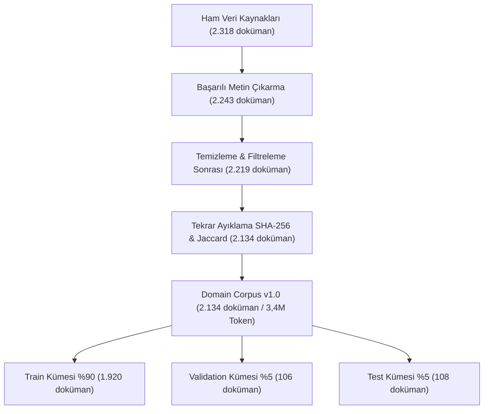

# Konsolide İstatistik Raporu (Statistics Report)

Bu rapor, veri setinin aşamalar boyunca nasıl işlendiğini, veri erimesini, token hacmini ve alt konu dağılımlarını *Vize Rehberi* 12. Bölümüne uygun olarak sunmaktadır.

---

## 1. Vize Raporu Sayısal Özeti (Summary Table)

*Vize Rehberi* değerlendirme şablonuna göre veri setimizin sayısal tablosu:

| Özellik | Değer |
| :--- | :--- |
| **Veri kaynağı sayısı** | 8 kurumsal sağlayıcı (105 dosya) |
| **Ham doküman / bölüm sayısı** | 2.318 |
| **Extraction başarılı** | 2.243 (%96,8) |
| **Extraction başarısız (OCR akışına yönlendirilen)** | 75 (%3,2) |
| **Temizleme ve filtreleme sonrası** | 2.219 |
| **Exact duplicate (SHA-256)** | 38 |
| **Near duplicate (MinHash + Jaccard $\ge 0.85$)** | 47 |
| **Final doküman sayısı (Domain Corpus v1.0)** | **2.134 doküman** |
| **Toplam kelime sayısı** | **1.009.778 kelime** |
| **Toplam karakter sayısı** | **12.907.476 karakter** |
| **Toplam token sayısı (Qwen 2.5 tokenizer)** | **3.395.898 token** |
| **Fransızca içerik oranı** | **%94,7** |
| **İngilizce içerik oranı (Uluslararası terminoloji)** | **%5,3** |
| **Manuel kontrol örneği (Domain Corpus)** | 200 doküman |
| **Manuel kalite başarısı (Domain Corpus)** | %97,5 |
| **Instruction örneği sayısı (Instruction Dataset v1.0)** | **4.348 örnek** |
| **Manuel kontrol örneği (Instruction Dataset)** | 150 örnek |
| **Manuel kalite başarısı (Instruction Dataset)** | %98,0 |

---

## 2. Verinin Aşamalar Boyunca Erimesi (Data Funnel)

---

## 3. Doküman Başına Token Dağılımı (Domain Corpus)

| Ölçüt | Değer (Token) |
| :--- | :--- |
| **Minimum Uzunluk** | 32 token |
| **Medyan Uzunluk** | 845 token |
| **Ortalama Uzunluk** | 1.591,3 token |
| **95. Yüzdelik (P95)** | 4.210 token |
| **Maksimum Uzunluk** | 28.650 token |

---

## 4. Alt Konu Dağılımı (Subtopics Breakdown)

| Alt Konu (Subtopic) | Doküman Sayısı | Oran (%) |
| :--- | :--- | :--- |
| Ekonomi ve Kamu Maliyesi | 455 | %21,3 |
| Hukuk, Adalet ve Çevre Mevzuatı | 399 | %18,7 |
| Tarih ve Cumhuriyet Kurumları | 312 | %14,6 |
| Sosyal İşler ve İstihdam | 221 | %10,4 |
| Halk Sağlığı (EDSG Verileri) | 151 | %7,1 |
| Eğitim ve Öğretim | 112 | %5,2 |
| Demografi ve Nüfus | 85 | %4,0 |
| Çevre, İklim ve Orman | 83 | %3,9 |
| Kamu Yönetimi | 82 | %3,8 |
| Genel Bilgiler | 55 | %2,6 |
| Kültür ve Turizm | 44 | %2,1 |
| Biyoçeşitlilik ve Korunan Türler | 36 | %1,7 |
| Altyapı ve Ulaşım | 30 | %1,4 |
| Enerji ve Madencilik | 27 | %1,3 |
| Tarım ve Balıkçılık | 23 | %1,1 |
| Coğrafya | 10 | %0,5 |
| Güvenlik ve Savunma | 9 | %0,4 |
| **Toplam** | **2.134** | **%100,0** |
